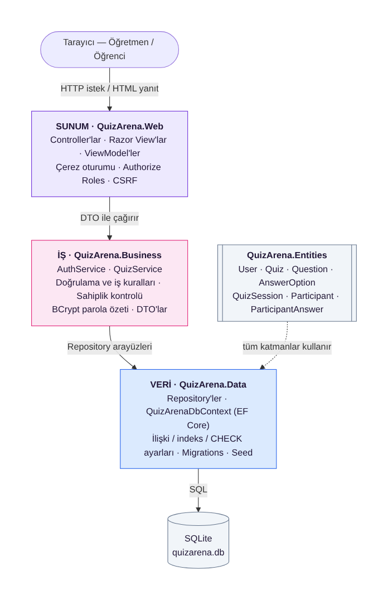

# QuizArena — Sınıf İçi Oyunlaştırılmış Quiz Yarışması

> Bilgisayar Uygulamaları I · Proje P60 · Bingöl Üniversitesi Bilgisayar Programcılığı

Öğretmenin quiz hazırlayıp sınıfta canlı oturum başlattığı, öğrencilerin katılım koduyla bağlanıp süreye karşı yarıştığı web uygulaması. Puan/lider tablosu, güç kartları ve oturum sonu analizi sonraki haftalarda eklenecek.



## Teknolojiler

C# · .NET 8 · ASP.NET Core MVC · Entity Framework Core 8 · SQLite · BCrypt · Bootstrap 5
(Hafta 9'da gerçek zamanlı iletişim için SignalR eklenecek.)

## Kurulum

### Gereksinimler
- [.NET 8 SDK](https://dotnet.microsoft.com/download/dotnet/8.0)
- Visual Studio 2022 (17.8+) **veya** VS Code + C# Dev Kit
- (İsteğe bağlı) [DB Browser for SQLite](https://sqlitebrowser.org/) — veritabanını görmek için

### İlk kurulum (bir kez)

**Windows (PowerShell):**
```powershell
powershell -ExecutionPolicy Bypass -File scripts\ilk-kurulum.ps1
```
**macOS / Linux:**
```bash
bash scripts/ilk-kurulum.sh
```

Betik şunları yapar: paketleri indirir (`dotnet restore`), `dotnet-ef` aracını kurar, ilk migration'ı oluşturur (`InitialCreate`), migration'ın SQL'ini `docs/database/migration.sql` dosyasına yazar ve projeyi derler.

<details>
<summary>Betik yerine komutları elle çalıştırmak istersen</summary>

```bash
dotnet restore
dotnet tool install --global dotnet-ef --version 8.0.11
dotnet ef migrations add InitialCreate --project src/QuizArena.Data --startup-project src/QuizArena.Web
dotnet build
```
</details>

> ⚠️ Migration'ı **uygulamayı ilk kez çalıştırmadan önce** oluştur. Migration yokken uygulama şemayı geçici olarak doğrudan oluşturur; sonradan migration eklersen `quizarena.db` dosyasını silip yeniden çalıştır.

### Çalıştırma

```bash
dotnet run --project src/QuizArena.Web
```
ya da Visual Studio'da `QuizArena.sln` → başlangıç projesi **QuizArena.Web** → F5.

İlk çalıştırmada `src/QuizArena.Web/quizarena.db` oluşturulur ve geliştirme ortamında sentetik örnek veriyle doldurulur.

### Demo hesaplar (yalnızca geliştirme ortamı, sentetik veri)

| Rol | E‑posta | Parola |
|---|---|---|
| Öğretmen | `ogretmen@quizarena.test` | `Ogretmen123!` |
| Öğretmen 2 | `ogretmen2@quizarena.test` | `Ogretmen123!` |
| Öğrenci | `ogrenci1@quizarena.test` … `ogrenci4@…` | `Ogrenci123!` |

Yeni öğretmen hesabı açmak için davet kodu (geliştirme): `OGRETMEN-2026`

## Yapılandırma

| Ayar | Dosya / ortam değişkeni | Açıklama |
|---|---|---|
| `ConnectionStrings:Default` | `appsettings.json` | SQLite dosya yolu |
| `Auth:TeacherInviteCode` | `appsettings.Development.json` · üretimde `Auth__TeacherInviteCode` | Öğretmen kayıt kodu (gizli) |
| `Auth:MaxFailedLoginAttempts`, `Auth:LockoutMinutes` | `appsettings.json` | Hesap kilitleme |
| `Database:SeedDemoData` | `appsettings.Development.json` | Örnek veri yüklensin mi |

Gizli bilgiler depoya **girmez**; yerel ayarlar için `appsettings.Development.local.json` ya da ortam değişkeni kullan (`.gitignore`'da).

## Proje yapısı

```
src/
├── QuizArena.Entities   → Varlıklar (User, Quiz, Question, AnswerOption, QuizSession, Participant, ParticipantAnswer)
├── QuizArena.Data       → DbContext, Fluent API ayarları, Repository'ler, Migrations, Seed
├── QuizArena.Business   → Servisler, iş kuralları/doğrulama, BCrypt, DTO'lar
└── QuizArena.Web        → MVC Controller'lar, View'lar, çerez kimlik doğrulama
docs/                    → ER diyagramı, mimari, haftalık notlar, güvenlik notu, SQL betikleri, AI günlüğü
scripts/                 → İlk kurulum betikleri
```

Ayrıntı: [docs/mimari.md](docs/mimari.md) · [docs/er-diyagrami.md](docs/er-diyagrami.md)

## Yol haritası

| Hafta | Konu | Durum |
|---|---|---|
| 3 | Kurulum, mimari ve veri modeli | ✅ [notlar](docs/haftalar/hafta-03.md) |
| 4 | Veritabanı tasarımı ve veri erişim katmanı | ✅ [notlar](docs/haftalar/hafta-04.md) |
| 5 | Kullanıcı yönetimi ve kimlik doğrulama | ✅ [notlar](docs/haftalar/hafta-05.md) · [güvenlik notu](docs/guvenlik-notu.md) |
| 6 | Çekirdek Modül A: Quiz oluşturma | ✅ [notlar](docs/haftalar/hafta-06.md) |
| 7 | Çekirdek Modül B: Canlı oturum ve katılım | ✅ [notlar](docs/haftalar/hafta-07.md) |
| 8 | VİZE: Ara sürüm (`v0.1.0` etiketi) | ⏳ |
| 9 | Gerçek zamanlı iletişim (SignalR / WebSocket) | ⏳ |
| 10 | Yapay zekâ ile otomatik soru üretimi | ⏳ |
| 11 | Puan, lider tablosu, güç kartları | ⏳ |
| 12 | Sonuç analizi ve rapor | ⏳ |
| 13 | Test ve hata ayıklama | ⏳ |
| 14 | Dokümantasyon ve dağıtım hazırlığı | ⏳ |
| 15 | Final sürüm ve savunma | ⏳ |

## Yapay zekâ kullanımı

Projede yapay zekâ destekli araçlar kullanılmaktadır; her kullanım [docs/rapor-ve-ai-gunlugu/](docs/rapor-ve-ai-gunlugu/) klasöründe (AI günlüğü + haftalık ilerleme raporu) belgelenir.
