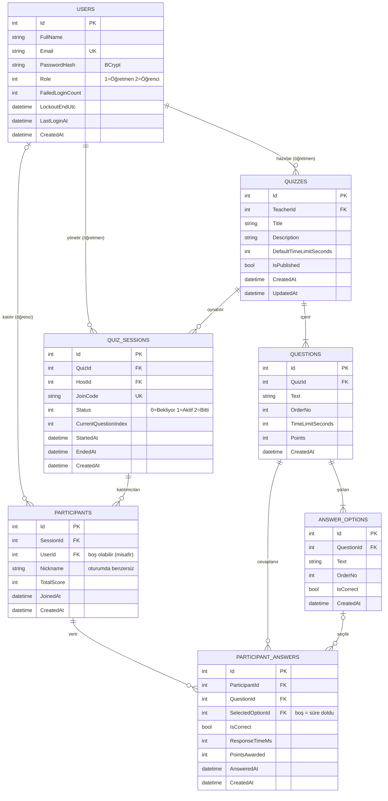

# ER Diyagramı — QuizArena

> Hafta 3 teslimi. Görsel hâli: [`er-diyagrami.png`](er-diyagrami.png). GitHub bu sayfadaki Mermaid kodunu otomatik çizer.

## Varlıklar (Entity)

| Varlık | Tablo | Açıklama |
|---|---|---|
| Kullanıcı | `Users` | Öğretmen ve öğrenci aynı tabloda; farkı `Role` sütunu |
| Quiz | `Quizzes` | Öğretmenin hazırladığı soru seti |
| Soru | `Questions` | Quizin soruları, sıra (`OrderNo`), süre ve puan |
| Şık | `AnswerOptions` | Sorunun şıkları; doğru olan `IsCorrect = 1` |
| Oturum | `QuizSessions` | Quizin sınıfta canlı oynatılması (katılım kodu ile) |
| Katılımcı | `Participants` | Oturuma katılan kişi (takma ad, toplam puan) |
| Cevap | `ParticipantAnswers` | Katılımcının bir soruya verdiği cevap |

## İlişkiler

| İlişki | Tür | Nasıl kuruldu | Silme davranışı |
|---|---|---|---|
| Kullanıcı → Quiz | 1‑N | `Quizzes.TeacherId` FK | **Restrict**: quizi olan öğretmen silinemez |
| Quiz → Soru | 1‑N | `Questions.QuizId` FK | **Cascade**: quiz silinince soruları da silinir |
| Soru → Şık | 1‑N | `AnswerOptions.QuestionId` FK | **Cascade** |
| Quiz → Oturum | 1‑N | `QuizSessions.QuizId` FK | **Restrict**: oturum geçmişi olan quiz silinemez |
| Kullanıcı → Oturum (yönetici) | 1‑N | `QuizSessions.HostId` FK | **Restrict** |
| Oturum ↔ Kullanıcı | **N‑N** | Ara tablo `Participants` (`SessionId`, `UserId`) | Oturum silinirse Cascade, kullanıcı silinirse `UserId = NULL` |
| Katılımcı ↔ Soru | **N‑N** | Ara tablo `ParticipantAnswers` (`ParticipantId`, `QuestionId`) | Katılımcı → Cascade, Soru → Restrict |

**Neden ara tabloya ayrı varlık?** N‑N ilişkiyi sadece iki FK'li bir tabloyla da kurabilirdik; ama ara tabloda ek bilgi (takma ad, puan, cevap süresi) tutmamız gerektiği için `Participant` ve `ParticipantAnswer` birer varlık oldu.

## Anahtarlar ve indeksler

| Tablo | Birincil anahtar | Benzersiz (UNIQUE) | Diğer indeksler |
|---|---|---|---|
| Users | Id | `Email` | – |
| Quizzes | Id | – | `TeacherId` |
| Questions | Id | – | `(QuizId, OrderNo)` |
| AnswerOptions | Id | – | `(QuestionId, OrderNo)` |
| QuizSessions | Id | `JoinCode` | `QuizId`, `HostId` (FK) |
| Participants | Id | `(SessionId, Nickname)` | `UserId` |
| ParticipantAnswers | Id | `(ParticipantId, QuestionId)` | `QuestionId`, `SelectedOptionId` |

Her tabloda yapay (surrogate) birincil anahtar `Id` (otomatik artan tamsayı) kullanıldı: kısa, değişmez ve FK olarak kullanması kolay. E‑posta gibi doğal anahtarlar değişebileceği için PK yapılmadı, sadece UNIQUE indeks verildi.

## CHECK kısıtları

- `Users.Role IN (1, 2)`
- `Quizzes.DefaultTimeLimitSeconds BETWEEN 5 AND 300`
- `Questions.TimeLimitSeconds BETWEEN 5 AND 300`, `Questions.Points BETWEEN 0 AND 5000`

## Normalizasyon

- **1NF:** Her hücrede tek (atomik) değer var. Şıklar bir sütunda virgülle ("A,B,C,D") tutulmadı; her şık `AnswerOptions` tablosunda ayrı satır.
- **2NF:** Tüm tablolarda tek sütunlu PK (`Id`) olduğu için kısmi bağımlılık oluşmaz; her sütun anahtarın tamamına bağlı.
- **3NF:** Geçişli bağımlılık yok. Örneğin cevap tablosunda öğretmen adı ya da quiz başlığı tekrar yazılmıyor; bunlar FK zinciri üzerinden (`Cevap → Soru → Quiz → Öğretmen`) bulunuyor.
- **Bilinçli tek istisna:** `Participants.TotalScore` aslında `ParticipantAnswers.PointsAwarded` toplamından hesaplanabilir. Canlı lider tablosunda her saniye toplama sorgusu çalıştırmamak için bilinçli olarak saklanıyor (performans için kontrollü denormalizasyon). Hafta 11'de puan, cevapla birlikte aynı işlem (transaction) içinde güncellenecek.
