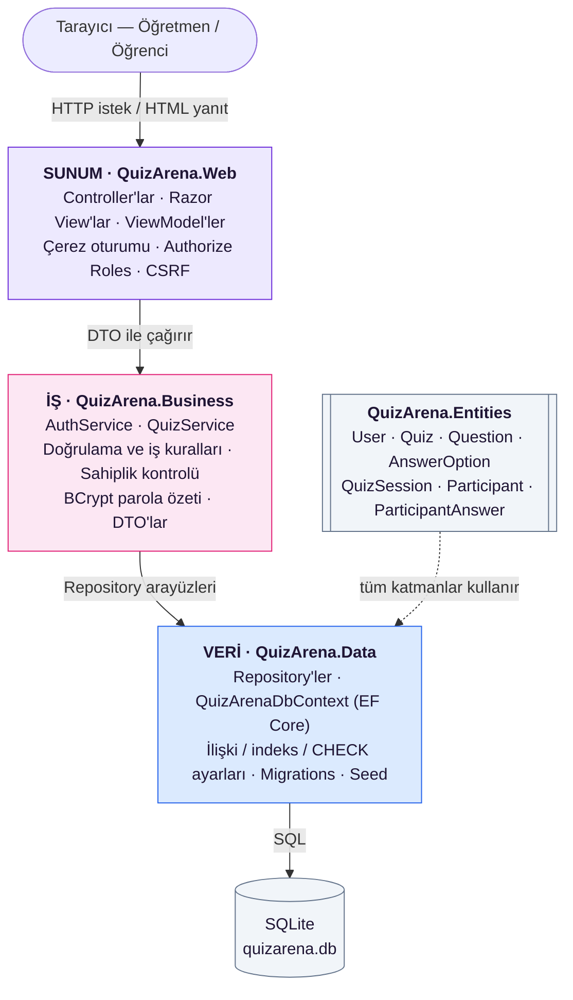

# Mimari — QuizArena

> Hafta 3 teslimi. Görsel hâli: [`mimari.png`](mimari.png).

## Teknoloji yığını

| Katman | Teknoloji | Neden |
|---|---|---|
| Dil / platform | C# · .NET 8 (LTS) | Derslerde C# kullanıyoruz; uzun süreli destekli sürüm |
| Web çatısı | ASP.NET Core MVC | Sunucu tarafında sayfa üretimi, hazır kimlik doğrulama ve yetkilendirme |
| Gerçek zamanlı (Hafta 9) | ASP.NET Core SignalR | .NET ile hazır gelen WebSocket kütüphanesi; bağlantı kopunca yeniden bağlanma desteği |
| ORM | Entity Framework Core 8 | Tabloları C# sınıflarıyla yönetme, migration desteği |
| Veritabanı | SQLite | Kurulum gerektirmez, tek dosya. EF Core sayesinde SQL Server'a geçiş tek satır |
| Parola özeti | BCrypt.Net-Next | Tuzlu (salt) ve yavaş özetleme; kaba kuvvete dayanıklı |
| Arayüz | Razor View + Bootstrap 5 | Duyarlı (mobil uyumlu) tasarım |

## Katmanlı mimari (sunum / iş / veri)



**Bağımlılık yönü tek yönlüdür:** Web → Business → Data → Entities. Alt katman üst katmanı tanımaz (Data, Web'den habersizdir). Böylece örneğin arayüzü ileride bir mobil uygulama ile değiştirsek iş kuralları aynen kalır.

## Katmanların sorumlulukları

| Proje | Sorumluluk | İçermez |
|---|---|---|
| **QuizArena.Entities** | Veritabanı tablolarına karşılık gelen sade sınıflar ve enum'lar | Hiçbir iş mantığı, hiçbir bağımlılık |
| **QuizArena.Data** | `DbContext`, tablo/ilişki/indeks ayarları, repository'ler, migration ve örnek veri | İş kuralları (ör. "en az 2 şık") |
| **QuizArena.Business** | İş kuralları, doğrulama, sahiplik kontrolü, parola özetleme, DTO'lar | HTTP, çerez, HTML |
| **QuizArena.Web** | HTTP istekleri, oturum çerezi, rol kontrolü, sayfalar | Doğrudan SQL / DbContext kullanımı |

## Klasör yapısı

```
QuizArena/
├── QuizArena.sln
├── README.md
├── .gitignore
├── docs/                         ← Dokümantasyon (ER, mimari, haftalık notlar, SQL)
├── scripts/                      ← İlk kurulum betikleri
└── src/
    ├── QuizArena.Entities/       ← Varlıklar + Enums/
    ├── QuizArena.Data/
    │   ├── QuizArenaDbContext.cs ← Tablolar + ilişki/indeks/kısıt ayarları (Fluent API)
    │   ├── Repositories/         ← IRepository<T>, QuizRepository ...
    │   ├── Seed/                 ← Sentetik örnek veri
    │   └── Migrations/           ← (dotnet ef ile oluşturulur)
    ├── QuizArena.Business/
    │   ├── Common/               ← Result (başarı/hata taşıyıcı)
    │   ├── Dtos/                 ← Katmanlar arası veri nesneleri
    │   ├── Helpers/              ← PasswordHelper (BCrypt)
    │   ├── Services/             ← AuthService, QuizService
    │   └── Validation/           ← İş kuralları ve sabitler
    └── QuizArena.Web/
        ├── Controllers/
        ├── Models/               ← ViewModel'ler
        ├── Views/
        └── wwwroot/              ← CSS, JS, Bootstrap
```

**Klasör mantığı:** Önce katmana göre (proje), sonra her katmanın içinde görev türüne göre (Services, Validation, Repositories...) ayrıldı. Yeni bir modül eklerken (ör. Hafta 7 Canlı Oturum) her katmanda ilgili klasöre bir dosya eklenir: `SessionService`, `SessionRepository`, `SessionController`.

## Değerlendirilen alternatifler

| Alternatif | Neden seçilmedi |
|---|---|
| Tek proje (her şey Web içinde) | Küçük projede hızlı ama iş kuralları controller'lara dağılır, test etmek zorlaşır ("her şeyi tek katmanda toplamak" sık yapılan hata) |
| Clean/Onion Architecture | Daha esnek ama bu ölçekte fazla soyutlama; öğrenme yükü yüksek |
| Razor Pages | MVC kadar yaygın değil; controller ayrımı katmanları anlatmayı kolaylaştırıyor |
| Node.js + Express | C# bilgimizi kullanamazdık |
| SQL Server | Her bilgisayarda kurulum gerektiriyor; geliştirme için SQLite yeterli |

## İstek akışı örneği: "Soru ekle"

1. Öğretmen formu gönderir → `POST /Quiz/AddQuestion?quizId=5`
2. ASP.NET Core CSRF token'ını kontrol eder (yoksa 400)
3. `[Authorize(Roles="Teacher")]` → giriş yapmamışsa giriş sayfasına, öğrenciyse "Erişim engellendi"
4. `QuizController` ViewModel'i doğrular, `QuestionInputDto`'ya çevirir
5. `QuizService.AddQuestionAsync` → quiz var mı (404) → bu öğretmenin mi (403) → kilitli mi → `QuizValidator` kuralları
6. `QuestionRepository.AddAsync` + `SaveAsync` → EF Core `INSERT` komutlarını tek işlemde çalıştırır
7. Başarılıysa quiz sayfasına yönlendirme + "Soru eklendi" mesajı
